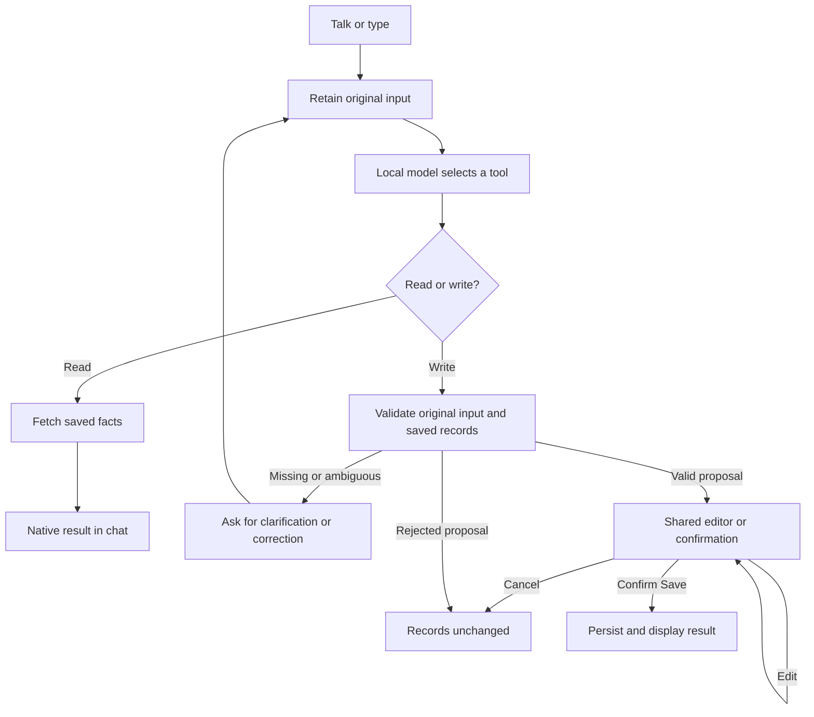
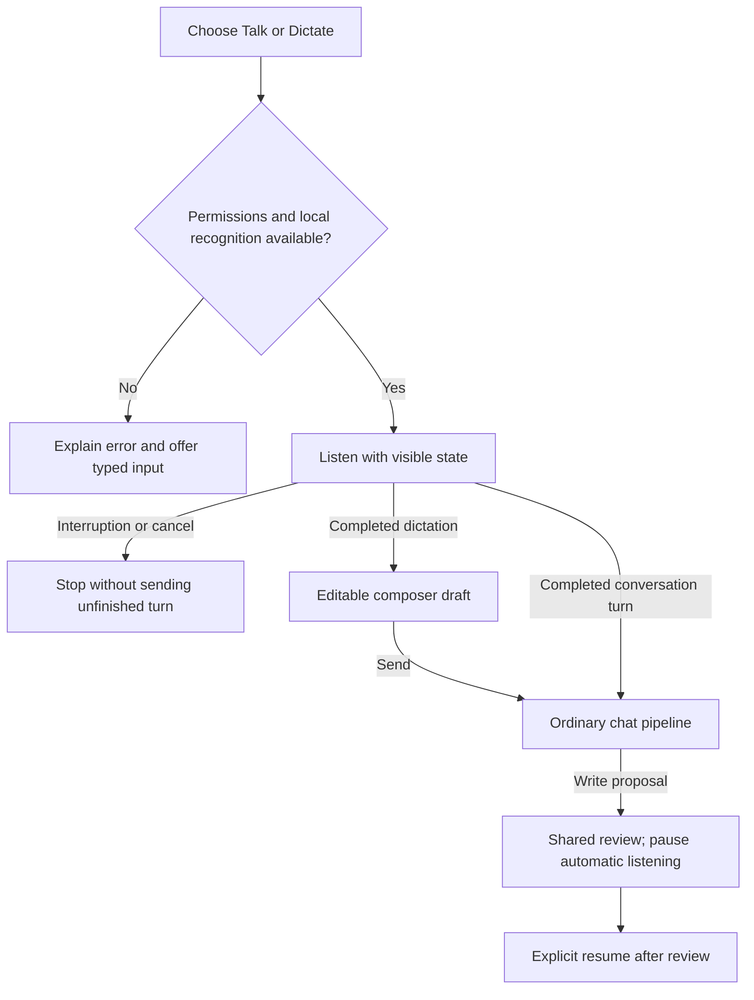
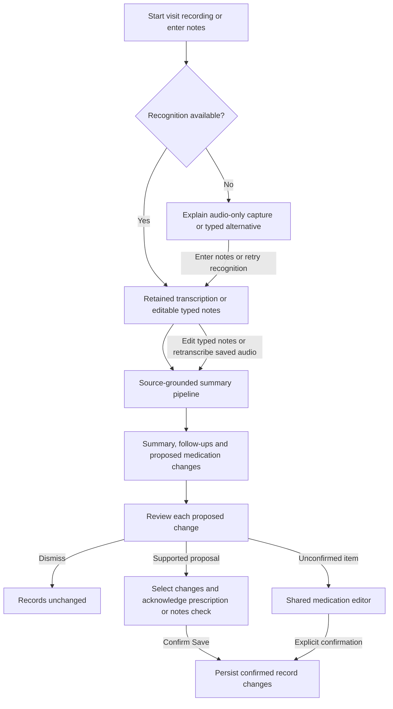

# Message, screen and review flows

Simple and Caregiver share the same agent, records and editors. These flows describe expected acceptance paths. Example wording is illustrative; generated routing can fail and still needs source validation. They are not transcripts of a live test.

## Screen entry map

| Story | Simple entry | Caregiver entry | Shared destination |
| --- | --- | --- | --- |
| MED-01 / MED-02 | Message or Talk | Chat or Records → Medications | Medication selection/editor and confirmation |
| REM-01 | Message or Talk | Chat / reminder actions | Reminder editor with date/time review |
| DOSE-01 | Message or Talk | Today / medication dose actions | Eligible dose outcome review |
| READ-01 / SYM-01 | Message or Talk | Chat or Records category | Reading/symptom draft and review |
| VOICE-01 | Talk; Message microphone for dictation | Chat voice/dictation control | Shared conversation/composer |
| VISIT-01 | Record a visit / Resume visit | Visits | Shared recorder, transcript, summary and proposal review |
| MODE-01 | Settings → Interface | Settings → Interface | Persisted layout preference and shared local records |

Simple's guide explains its primary actions. Caregiver exposes Today, Chat, Records and Visits. See [navigation conventions](navigation-and-actions.md) and [interface details](simple-and-caregiver.md).

## Chat routing and human confirmation

A selected tool does not prove the source facts are valid. An opened draft does not establish a saved operation. Frequency descriptions must not silently become particular clock reminders.

## Representative English/French message exchanges

The app responses below specify the expected surface and user action, rather than promising exact generated prose.

| Story | User message examples | Expected app response / next user action |
| --- | --- | --- |
| MED-01 | EN: “Add metformin to my medications.” FR: “Ajoute metformine à mes médicaments.” | Open the common medication review. The person checks product/instructions, edits if needed, and chooses Save or Cancel. |
| MED-01 recovery | EN: “Add hydroclorothiazide.” FR: “Ajoute hydroclorothiazide.” | An uncertain name requires clarification/manual candidate selection. Similar names never silently rewrite the transcript or authorize a write. |
| MED-02 | EN: “Update my metformin to 400 mg.” FR: “Modifiez la metformine à 400 mg.” | Show the supported correction in a draft while retaining unrelated recorded directions. The person checks it before Save. |
| REM-01 | EN: “Remind me to book blood work.” FR: “Rappelle-moi de prendre rendez-vous pour une prise de sang.” | Open a task draft; choose/confirm a date and time. This does not book an appointment. |
| DOSE-01 | EN: “I took my metformin.” FR: “J’ai pris ma metformine.” | Resolve one saved medicine and eligible slot or ask for clarification. Review/confirm the outcome. |
| READ-01 | EN: “My pulse is 72.” FR: “Mon pouls est de72.” | Show a heart-rate draft with 72 bpm; correct it or Save. An incomplete/invalid value requires restatement. |
| SYM-01 | EN: “Record that I have a cough.” FR: “Note que j’ai une toux.” | Preserve the source description in a symptom draft. The person reviews details/signs and then Save or Cancel. |
| Read-only recovery | EN: “What dose of metformin is saved?” FR: “Quelle dose de metformine est enregistrée ?” | Show the saved fact when available or ask for missing context; create no correction draft from the question alone. |
| Negation | EN: “Do not remove my metformin.” FR: “Ne supprime pas ma metformine.” | Preserve records. Any incorrect model write proposal must be rejected by validation. |

Examples inherit the [user-story preconditions](user-stories.md). Missing saved medicines or dose slots require clarification, not invented records. French display labels can differ while saved IDs/units remain canonical and source quotations remain verbatim.

### Illustrative assistant wording for design review

These exchanges propose conversational copy. The current app generates wording and uses native review states; these are not recorded outputs or fixed production responses. The confirmation boundary is the acceptance requirement.

| Language | User | Illustrative assistant | Review / next step |
| --- | --- | --- | --- |
| EN | “Add metformin to my medications.” | “Please review the medication details before saving.” | Open MED-01 review; the person checks the product and chooses Save or Cancel. |
| FR | “Ajoute la metformine à mes médicaments.” | « Vérifiez les détails du médicament avant d’enregistrer. » | Same shared review; no save is claimed before confirmation. |
| EN | “Update my metfulsin to 400 mg.” | “Please restate the exact saved medication name and the correction.” | Preserve records; wait for a complete corrected request. |
| EN | “Update my metformin to 400 mg.” | “Review the recorded dose change before saving.” | MED-02 review, with one unchanged unit and other directions preserved. |
| FR | “Mon pouls est de72.” | « Vérifiez la mesure avant de l’enregistrer. » | READ-01 draft shows heart rate 72 bpm; the person can edit or cancel. |
| EN | “Remind me to book blood work.” | “Choose a date and time for this reminder.” | REM-01 draft requires date/time review; no appointment is booked. |

## Task-specific review paths

| Task | Draft/review path | Correction / cancel boundary |
| --- | --- | --- |
| Add/correct medication | Identify → choose candidate if needed → inspect name/instructions → confirm product → Save | Edit before Save; unknown ingredients remain unconfirmed; Cancel preserves records. |
| Reminder | State task → review title → choose/confirm due date/time → Save | Correct date/title or Cancel; notification failure stays visible. |
| Dose outcome | Identify medicine/slot → review Taken/Skipped/Remind later → confirm | Clarify ambiguity; Cancel makes no change; snoozing does not log Taken. |
| Reading | State supported type/value → review canonical value/unit → Save | Malformed/out-of-range facts need correction; Cancel creates nothing. |
| Symptom | Original description → review details/signs → Save | No inferred onset/severity; cancel leaves prior records intact. |
| Interface | Read shared-record explanation → choose layout → return Home | Saved data and draft survive; layout choice persists. |

## Voice recovery

End voice releases audio ownership and restores any saved typed draft. Returning Home or changing the layout must retain an ordinary unsent draft (#11). A media-service failure must not restart recording silently. See [voice behavior and device limits](voice-conversation.md).

## Visit and medication review

The audio-only branch does not imply a transcript was produced. Speaker attribution, acoustic accuracy and clinical completeness require separate evidence.

## Recovery map and evidence

| Trigger | Expected recovery | Relevant reference |
| --- | --- | --- |
| Uncertain name | Restate or manually review candidates; no automatic fuzzy identity. | [Vocabulary](medication-vocabulary.md) |
| Invalid reading | Correct the value/type before review can save. | [French records](french-records.md) |
| Missing correction details | Restate one exact medicine and change. | [Corrections](medication-chat-changes.md) |
| Cancel a write | Dismiss draft with prior records unchanged. | [Navigation](navigation-and-actions.md) |
| Stop during generation | Drain cancellation before another request can apply results. | [Chat behavior](chat-agent.md) |
| Denied/unavailable speech | Visible error; typed input remains available. | [Health and voice](health-and-voice.md) |
| Interrupted listening | Release audio without sending an unfinished partial. | [Voice conversation](voice-conversation.md) |
| Audio-only visit | Retain audio, explain transcription limits, allow notes/retry. | [Doctor visits](doctor-visits.md) |

[User stories](user-stories.md) distinguish current features, expected acceptance paths and unvalidated hypotheses. The [prepared usability tasks](usability-session-plan.md) are awaiting the deferred #13 trial; automated walkthroughs do not supply participant feedback.
