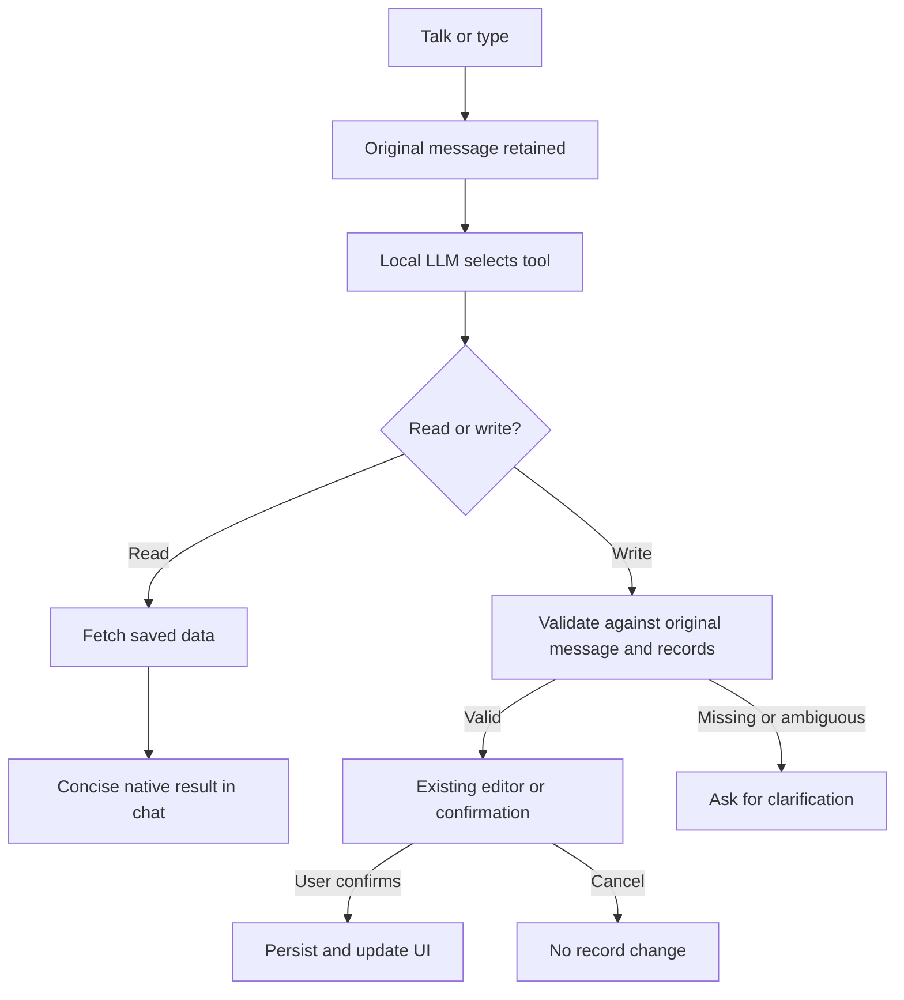
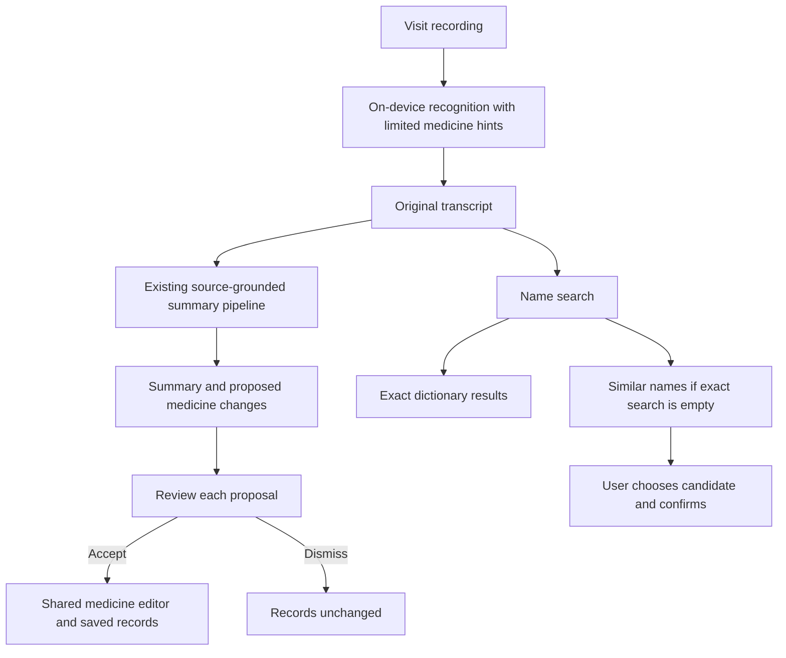

# Message and review flows

Both interfaces share the same agent and saved records. The diagrams show where model inference, deterministic source checks and human confirmation occur.

## How to change it

Update diagrams with tool routing, confirmation or recording changes. Keep original input separate from candidate suggestions. Never add a parallel manual record editor for Simple mode: use the shared one. Visit processing details remain in [summary extraction](visit-summary-extraction.md); name hints are documented in [vocabulary](medication-vocabulary.md).

## Configuration and dependencies

Uses AppStore, ToolPlanner, source validators, ModelManager, Apple Speech and native SwiftUI editors. Interface selection changes entry points, not tool permissions or stored data.
